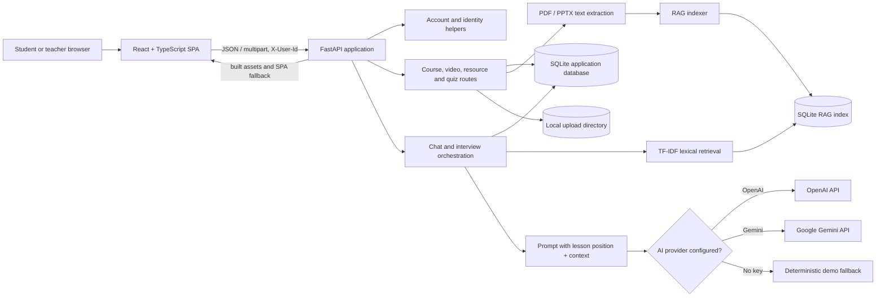

# LearnSphere AI

**A timestamp-aware AI learning workspace for video lessons, course resources, practice quizzes, and mock interviews.**

LearnSphere combines a React learning interface with a FastAPI service. Learners can ask questions about lesson material, receive explanations informed by the current playback position and retrieved course content, practice generated quizzes, and rehearse technical interviews. Teachers can organize courses and upload videos and learning resources.

> **Hackathon scope note:** This repository is a working prototype. Its RAG retriever is lexical TF-IDF/cosine similarity, not a neural embedding or vector-database system. Uploaded video transcripts are currently generated placeholder text, not speech-to-text transcriptions. Be clear about these limits when presenting evaluation results.

## Contents

- [Features](#features)
- [Technology stack](#technology-stack)
- [Architecture](#architecture)
- [Learning and RAG workflow](#learning-and-rag-workflow)
- [Quick start](#quick-start)
- [Configuration](#configuration)
- [API documentation](#api-documentation)
- [Sample dataset](#sample-dataset)
- [Deployment](#deployment)
- [Data, security, and production notes](#data-security-and-production-notes)
- [Project layout](#project-layout)
- [Evaluation and extension roadmap](#evaluation-and-extension-roadmap)

## Features

- **Course and lesson workspace:** Browse courses, upload lessons, inspect duration, and stream uploaded video files.
- **Timestamp-aware tutor:** Ask questions with a playback position and optional video ID. The backend includes the lesson title, duration, current position, transcript text, supplied context, and retrieved resource chunks in the tutor prompt.
- **Resource center:** Upload PDF and PowerPoint resources; extract text and index it for retrieval; view and download resources.
- **RAG search:** Split text into overlapping chunks, index it in SQLite, and rank relevant chunks using token overlap and cosine similarity.
- **Quiz practice:** Generate quizzes from lesson transcript and linked notes, submit answers, and receive per-question explanations and a score. A default quiz is created when a video is uploaded.
- **Mock interviews:** Generate role/topic/difficulty-specific questions, evaluate answers on relevance, clarity, and depth, and save session summaries.
- **Learning activity:** Store chat history, quiz attempts, interview sessions, and aggregate learner statistics.
- **Speech output:** Optional neural text-to-speech route powered by Edge TTS.
- **Fallback demo mode:** The app can run without a language-model key. Responses in this mode are canned demonstrations and must not be represented as live model output.

## Technology stack

| Area | Implementation |
|---|---|
| Web client | React 19, TypeScript, Vite 8, Tailwind CSS v4 |
| API | Python 3.11+, FastAPI, Pydantic, Uvicorn |
| Persistence | SQLite for users, courses, videos, resources, quizzes, activity, and RAG index |
| RAG | Custom character chunker, tokenizer, term-frequency vectors, cosine similarity, SQLite chunk/document tables |
| Generative AI | OpenAI Chat Completions or Google Gemini `generateContent`; OpenAI takes precedence when both keys exist |
| Documents/media | `pypdf`, `python-pptx`, `python-multipart`, `ffmpeg` in Docker; custom MP4 duration inspection |
| Speech | `edge-tts` when installed/configured by the runtime |
| Packaging | Unified FastAPI + built Vite app, Docker, and included Vercel routing configuration |

## Architecture



### Runtime request flow

1. The browser sends API requests to the same origin. The frontend helper adds `X-User-Id` and `X-User-Role` headers.
2. FastAPI validates request bodies with Pydantic and applies an in-memory per-user limit to selected AI routes.
3. For tutor chat, the backend loads the requested video record, searches the RAG index, combines retrieved text with client context and the stored transcript, and calls the selected provider.
4. The answer and lesson position are saved to SQLite and returned to the browser.
5. On startup, the service initializes both databases, creates upload directories, and attempts to reindex extracted resource text and stored video transcript text.

## Learning and RAG workflow

### Ingestion

- A video upload is saved under `UPLOAD_DIR/videos`. The current implementation inspects MP4 duration when possible (or estimates a fallback duration), then creates a placeholder transcript/summary and a starter quiz. **It does not currently transcribe the uploaded audio/video.**
- A resource upload is saved under `UPLOAD_DIR/documents`. PDF and PowerPoint text extraction is handled by `backend/app/media_utils.py`; extracted text is stored with the resource and indexed immediately when non-empty.
- The indexer uses 300-character chunks, approximately 50-character overlap, a 50-character minimum, and a 50-chunk per-document cap. It stores source metadata and tokenized chunk text in `data/rag.db`.

### Retrieval and generation

- Query and chunk terms are lowercased, punctuation is removed, short terms and a small stopword list are discarded.
- Each chunk is represented by normalized term frequencies; the query and chunks are ranked by cosine similarity. The implementation names TF-IDF, but chunk retrieval vectors do **not** use corpus-wide IDF weights.
- Retrieval returns up to five chunks by default. Tutor context uses up to six chunks (with up to three video-specific results prioritized) and a rough 2,000-token character budget.
- The prompt includes question, lesson title, duration, current playback position, caller-provided context, stored transcript, and retrieved text. The application does not currently enforce a structured citation format, calibrated confidence threshold, or answer abstention policy.
- Quiz generation and interview generation/evaluation use JSON-oriented prompts. Provider output is parsed and normalized; there is a development fallback if no key is configured.

### Timestamp behavior and accuracy limits

`lessonTime` is passed to the tutor prompt and stored with chat history. The current uploaded-video placeholder transcript has only generic time labels (`00:00`, `00:30`, `01:15`), so timestamp precision is not evidence of actual audiovisual alignment. The sample JSON dataset contains authored timestamps for documentation/demo purposes; it is not automatically loaded into the application database. For a real timestamp-grounded demonstration, provide verified transcript segments with start/end times and implement ingestion that preserves those offsets.

## Quick start

### Prerequisites

- Python 3.11 or later
- Node.js 20 or later and npm
- Windows users can use `run.bat`; Docker users can follow [Deployment](#deployment).

### Windows one-click launcher

Run `run.bat` from the project directory. It checks prerequisites, installs missing dependencies, can prompt for an AI key, and starts the unified app at `http://127.0.0.1:8000`. Keep its terminal open while using the app.

### Manual setup

```powershell
npm install
python -m venv .venv
.\.venv\Scripts\Activate.ps1
pip install -r requirements.txt
pip install -r backend/requirements.txt
```

Set one provider key (optional for demo mode):

```powershell
$env:GEMINI_API_KEY = "your-gemini-key"
# or
$env:OPENAI_API_KEY = "your-openai-key"
```

Build the frontend and start the unified service:

```powershell
npm run build
python run.py
```

Open `http://127.0.0.1:8000`. Interactive API documentation is at `http://127.0.0.1:8000/docs`; OpenAPI JSON is at `/openapi.json`.

For frontend-only development with hot reload, use `npm run dev` in a separate terminal. Configure the Vite proxy in `vite.config.ts` as appropriate for your backend URL; the default production architecture serves the built SPA from FastAPI.

## Configuration

The Python service reads environment variables from its process environment. `.env.example` currently documents optional Firebase web-client values; it is not a Python dotenv loader. Set server variables in the shell, container, or hosting provider.

| Variable | Default | Description |
|---|---|---|
| `GEMINI_API_KEY` | unset | Gemini credential; used if no valid OpenAI key is configured |
| `GEMINI_MODELS` | `gemini-2.5-flash` | Comma-separated Gemini model fallback order |
| `GEMINI_MODEL` | `gemini-2.5-flash` | Single Gemini model when `GEMINI_MODELS` is absent |
| `OPENAI_API_KEY` | unset | OpenAI credential; takes precedence over Gemini |
| `OPENAI_MODEL` | `gpt-4o-mini` | OpenAI model name |
| `RATE_LIMIT_PER_10MIN` | `50` | In-memory AI requests per user in a rolling 10-minute window |
| `DATABASE_PATH` | `./data/app.db` | Main SQLite database file |
| `UPLOAD_DIR` | `./data/uploads` | Uploaded video/document root; service creates `videos/` and `documents/` |
| `FRONTEND_DIST` | repository `dist/` | Built frontend directory served by FastAPI |
| `HOST` | `127.0.0.1` | Host used by `run.py` |
| `PORT` | `8000` (`7860` in Docker) | HTTP port |
| `CORS_ORIGINS` | empty | Comma-separated origins; empty allows wildcard origins without credentials |
| `VERCEL` | unset | Platform marker; default DB/upload locations move to ephemeral `/tmp` paths |

The RAG module currently defaults to `./data/rag.db` and does not expose an environment variable for its path.

## API documentation

All paths are relative to the app origin. FastAPI generates the canonical schemas at `/docs` and `/openapi.json`; refer to those for exact response models. Most JSON routes accept and return JSON. File uploads use `multipart/form-data`.

### Identity and errors

- Most user-scoped routes require `X-User-Id`, matching `^[A-Za-z0-9_.-]{3,128}$`. The frontend generates a browser/session identifier and sends it automatically.
- This header is an identifier, **not a secure authorization token**. Some content read routes are public; delete routes check the optional `X-User-Role` header for the `teacher` value but do not bind that role to a verified server-side session.
- Registration/login endpoints return an app session ID, but the API does not validate that ID as a bearer credential on subsequent requests.
- Common errors: `400` invalid identity/input, `401` login failure, `403` role check failure, `404` missing resource, `409` invalid interview state, `422` schema validation, `429` AI rate limit, `500` internal operation failure, `502`/`503` provider failure.

### Endpoint reference

| Method | Path | Identity / input | Purpose |
|---|---|---|---|
| `POST` | `/api/auth/register` | JSON `name,email,password,role?,avatar_url?` | Create account; password is PBKDF2-SHA256 hashed in SQLite |
| `POST` | `/api/auth/login` | JSON `email,password,role?` | Verify account and return user/session ID |
| `POST` | `/api/auth/google` | JSON `email,name,role?,avatar_url?` | Upsert a Google-provider profile; backend trusts supplied profile fields |
| `POST` | `/api/auth/set-role` | JSON `email,role` | Return existing profile; registered role remains locked |
| `GET` | `/api/auth/user?email=...` | Query email | Read profile (password hash omitted) |
| `GET` | `/api/health` | Public | API status and active AI provider/model configuration |
| `GET` | `/api/stats` | `X-User-Id` | User activity counts and recent interview focus areas |
| `POST` | `/api/history/event` | `X-User-Id`; JSON `type?,title,detail?,video_id?,lesson_time?` | Record a learning activity event |
| `GET` | `/api/history` | `X-User-Id` | Combined recent chat, interview, and quiz activity |
| `DELETE` | `/api/history`, `/api/me/data` | `X-User-Id` | Delete that identifier's chat, interview, and quiz activity |
| `GET` | `/api/courses` | Optional `X-User-Role` | List courses; student role hides empty/default teaching course entries |
| `POST` | `/api/courses` | `X-User-Id`; JSON `title,description?,instructor?,thumbnail?` | Create or return same-title course |
| `PUT` | `/api/courses/{course_id}` | `X-User-Id`; partial course JSON | Update course fields |
| `DELETE` | `/api/courses/{course_id}` | Optional identity/role headers | Delete course; non-teacher role is rejected when supplied |
| `GET` | `/api/videos` | Public | List videos |
| `GET` | `/api/courses/{course_id}/videos` | Public | List course videos |
| `GET` | `/api/videos/{video_id}` | Public | Get video metadata/details |
| `POST` | `/api/videos/upload` | `X-User-Id`; multipart `file,title,course_id?,new_course_title?,new_course_desc?,new_course_instructor?,lesson_topic?,duration?` | Save video, create placeholder transcript/summary, and starter quiz |
| `DELETE` | `/api/videos/{video_id}` | Optional identity/role headers | Delete video; role check applies when role supplied |
| `GET` | `/api/media/videos/{filename}` | Public | Stream uploaded media file |
| `GET` | `/api/resources?course_id=&video_id=` | Public | List resources and download URLs; filters can be combined |
| `POST` | `/api/resources/upload` | `X-User-Id`; multipart `file,title?,course_id?,video_id?` | Save/extract/index PDF or PPT resource text |
| `GET` | `/api/resources/download/{resource_id}` | Public | Download resource and increment download count |
| `GET` | `/api/resources/{resource_id}/view` | Public | Get resource details |
| `DELETE` | `/api/resources/{resource_id}` | Optional identity/role headers | Delete resource; role check applies when role supplied |
| `POST` | `/api/chat` | AI limit + `X-User-Id`; JSON below | Retrieve lesson context, call tutor, and save answer/history |
| `POST` | `/api/voice/tts` | JSON `text,voice?` | Return generated audio (`audio/mpeg`) |
| `GET` | `/api/quiz/video/{video_id}` | Public | Get existing quiz or generate one if absent |
| `POST` | `/api/quiz/generate` | AI limit + `X-User-Id`; multipart `video_id` | Regenerate quiz using transcript and video-linked notes |
| `POST` | `/api/quiz/submit` | `X-User-Id`; JSON `quiz_id,answers[]` | Grade quiz, store attempt, return score and explanations |
| `POST` | `/api/interview/start` | AI limit + `X-User-Id`; JSON below | Create role/topic/difficulty interview session |
| `POST` | `/api/interview/{session_id}/answer` | AI limit + `X-User-Id`; JSON `question_index,answer` | Evaluate and save one answer |
| `POST` | `/api/interview/{session_id}/finish` | `X-User-Id` | Finish session and return summary; requires an answer |
| `GET` | `/api/interview/sessions` | `X-User-Id` | List up to 25 user's sessions |
| `GET` | `/api/interview/{session_id}` | `X-User-Id` | Get owned session, answers, feedback, and summary |
| `GET` | `/api/rag/stats` | No identity check currently | Counts of indexed documents/chunks |
| `POST` | `/api/rag/reindex` | No identity check currently | Reindex resources and video transcripts from main DB |
| `POST` | `/api/rag/clear` | No identity check currently | Clear all indexed chunks/documents |
| `POST` | `/api/rag/search` | JSON `query,source_id?,source_type?,top_k?`; no identity check currently | Search RAG chunks and return ranked text/source metadata |

### Chat request example

```http
POST /api/chat
Content-Type: application/json
X-User-Id: demo-user-01

{
  "question": "What is the difference between classification and regression?",
  "context": "Optional text currently visible in the lesson workspace",
  "lessonTime": 48,
  "videoId": 1
}
```

`question` is 1–4,000 characters, `context` is at most 50,000 characters, and `lessonTime` must be non-negative. Response: `{"answer":"...","lessonTime":48}`.

### Interview request example

```json
{
  "role": "Junior Python Developer",
  "topic": "APIs and databases",
  "difficulty": "intermediate",
  "num_questions": 3
}
```

Allowed difficulties are `beginner`, `intermediate`, `advanced`; `num_questions` is `1`, `3`, `5`, or `7`.

### RAG search request example

```http
POST /api/rag/search
Content-Type: application/json

{"query":"held-out test data","top_k":5,"source_type":"resource"}
```

The route returns `{"ok":true,"chunks":[{"source_id":"...","source_title":"...","text":"...","relevance_score":0.42}],"count":1}`. RAG maintenance routes are currently unauthenticated and should be restricted before public deployment.

## Sample dataset

The repository includes two sample files under [`data/sample/`](data/sample/):

- [`learnsphere-sample-dataset.json`](data/sample/learnsphere-sample-dataset.json): four authored lessons (supervised learning, neural networks, gradient descent, and backpropagation), timestamped transcript snippets, summaries, and a three-question supervised-learning quiz. It is synthetic/example educational content, not a training corpus, user data, or automatically imported runtime seed.
- [`sample-house-prices.csv`](data/sample/sample-house-prices.csv): 16 synthetic rows with `area_sqft`, `bedrooms`, `age_years`, and `price_usd`, illustrating features and a regression label. It is not real property market data and is not consumed by the application.
- [`README-sample-data.md`](data/sample/README-sample-data.md): dataset provenance and limitations.

The running service seeds course catalog entries in SQLite when the database is empty, but this sample JSON/CSV bundle is separate. Do not claim the CSV was used to train LearnSphere's tutor or RAG system.

## Deployment

### Docker (single-service deployment)

The included Dockerfile builds the Vite frontend and serves it with FastAPI. It uses port `7860` by default.

```bash
docker build -t learnsphere-ai .
docker run --rm -p 7860:7860 \
  -e GEMINI_API_KEY="your-key" \
  -e DATABASE_PATH=/app/data/app.db \
  -v learnsphere-data:/app/data \
  learnsphere-ai
```

Open `http://localhost:7860`; API docs: `http://localhost:7860/docs`. Set `OPENAI_API_KEY` and optionally `OPENAI_MODEL` instead to use OpenAI. Persist `/app/data` and uploaded files for a single-container demo; uploads are under `/app/data/uploads` by default.

### Vercel

`vercel.json` defines separate Vite frontend and FastAPI backend services and routes `/api/*` to the backend, with other paths sent to the frontend. Deploy from this repository root and configure the AI provider key(s) in Vercel project environment settings. Confirm the platform's current Python function support, build settings, and request/file limits before judging a deployment ready.

**Persistence caveat:** this code uses local SQLite and local upload files. In Vercel/serverless mode the main database and uploads default to `/tmp`, which is ephemeral and instance-local; the RAG index uses its own relative local path as well. Data may disappear or diverge between instances. Use managed persistent database and object storage (and a durable RAG index) before a multi-instance/production deployment.

### Other Python hosting

Build the frontend, install both Python requirement files, configure environment variables, and run:

```bash
npm ci && npm run build
pip install -r requirements.txt -r backend/requirements.txt
HOST=0.0.0.0 PORT=8000 uvicorn backend.app.main:app --host 0.0.0.0 --port 8000
```

Mount persistent storage for `DATABASE_PATH`, `UPLOAD_DIR`, and the RAG database location (currently `./data/rag.db`). Put the service behind HTTPS and a reverse proxy; configure `CORS_ORIGINS` to the exact frontend origins if serving the client separately.

## Data, security, and production notes

- **Authentication is prototype-grade.** Account APIs exist, but session IDs are not verified as authorization credentials by protected routes. `X-User-Id` is client supplied and can be spoofed; role checks on some mutations also rely on client-supplied `X-User-Role`. Add signed sessions/OIDC and enforce ownership/roles server-side before handling real accounts or private content.
- **AI key handling:** keep provider keys only in server-side environment configuration. Never use `VITE_` variables for secret keys or commit `.env` files.
- **Upload hardening:** production deployments need file size/type limits, content validation, malware scanning, safe download policy, and durable object storage. The current upload routes copy submitted files directly to local disk.
- **RAG grounding:** retrieval is lexical and small-corpus oriented. Add a relevance evaluation set, citation metadata (including page and verified time offsets), abstention behavior, and adversarial prompt-injection handling before making accuracy claims.
- **Rate limits:** the AI limit is in-memory, so it resets on restart and is not shared across workers/instances.
- **Privacy and deletion:** `/api/me/data` deletes activity rows for the supplied user ID, but does not delete the account, uploaded content, or resources. Define retention and ownership policies for a real deployment.
- **Observability:** configure structured logs, provider latency/error metrics, request IDs, and cost/token tracking for hosted evaluation.

## Project layout

```text
LearnSphere/
├── src/                         # React UI, auth context, API client
├── backend/
│   ├── app/main.py               # FastAPI routes, schemas, app lifecycle
│   ├── app/ai.py                 # Gemini/OpenAI calls, prompt and fallback logic
│   ├── app/rag.py                # Chunking, lexical retrieval, RAG SQLite index
│   ├── app/db.py                 # Application SQLite schema and persistence
│   ├── app/media_utils.py        # Duration inspection and document extraction
│   ├── requirements.txt
│   └── tests/                    # pytest API and feature tests
├── api/index.py                  # Serverless backend entry point
├── data/sample/                  # Documentation/demo dataset
├── public/                       # Static assets
├── Dockerfile
├── vercel.json
├── run.py                        # Unified local server
├── run.bat                       # Windows launcher
└── README.md
```

## Evaluation and extension roadmap

For a defensible hackathon evaluation, report measured results from a fixed set of questions and source documents rather than broad claims. Useful next steps:

1. Replace placeholder transcripts with speech-to-text ingestion that stores sentence/segment timestamps and transcript provenance.
2. Build a small answer-grounding benchmark: question, expected source chunk, expected timestamp/page, relevance/faithfulness rating, and abstention expectation. Track retrieval hit rate, answer relevance, citation correctness, and unsupported-claim rate.
3. Return structured source references to the UI and require the model to answer from retrieved evidence or explicitly say the source does not contain the answer.
4. Add unit/integration tests for extraction, RAG ranking, timestamp selection, provider errors, auth/role enforcement, uploads, and deletion. Run the existing pytest suite as part of CI.
5. Move identity to verified sessions, rate limiting to shared storage, uploads to object storage, and SQLite to a managed database for multi-instance use.
6. Measure latency and provider usage; cache deterministic retrieval, cap context, and select a cost-appropriate model based on the measured quality/latency trade-off.

## License

The existing README describes this project as MIT licensed, but a `LICENSE` file was not present in the inspected project root. Add the license text before redistributing under that license.
